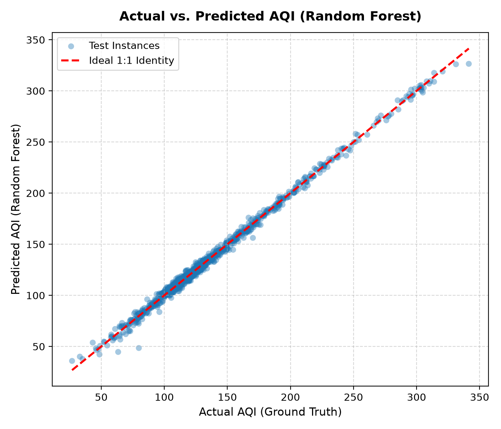
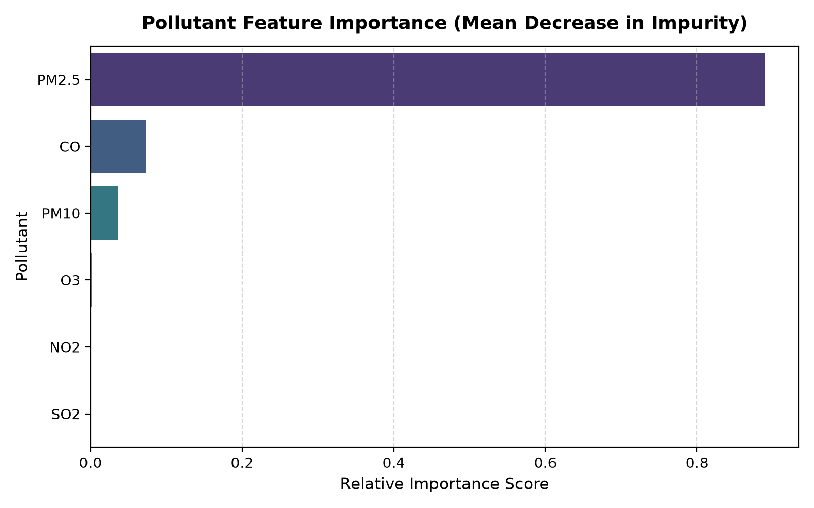
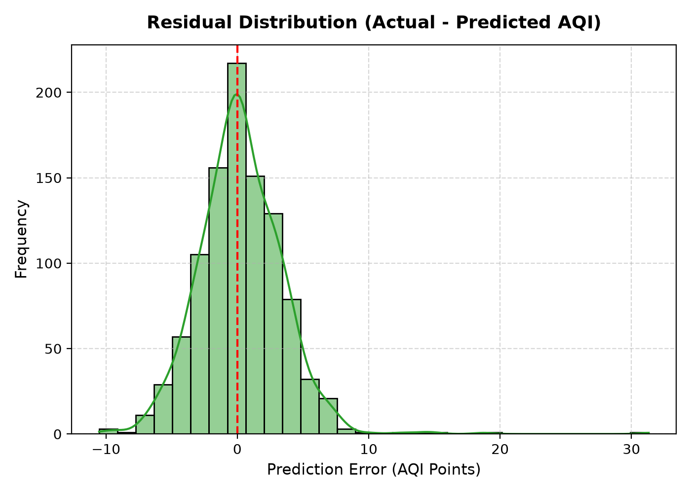

# 🌫️ Air Quality Index (AQI) Prediction from Pollutant Levels

[](https://www.python.org/)
[](https://scikit-learn.org/)
[](https://streamlit.io/)
[](LICENSE)
[](reports/CLA3_Air_Quality_Index_Report.pdf)

An end-to-end Machine Learning Case Study predicting continuous **Air Quality Index (AQI)** values and categorizing health risks directly from ambient multi-pollutant concentrations ($PM_{2.5}, PM_{10}, NO_2, SO_2, CO, O_3$).

---

## 📌 Executive Summary

Ambient air pollution is a leading global public health hazard contributing to millions of premature deaths yearly. Standard regulatory AQI calculations rely on piecewise linear interpolations across individual pollutant sub-indices followed by a max-operator aggregation, making real-time predictive forecasting challenging.

This project implements and benchmarks supervised machine learning models to predict continuous AQI scores directly from ambient concentrations. Using an ensemble **Random Forest Regressor**, the model achieves an **$R^2$ of 0.9958** and a **Mean Absolute Error (MAE) of 2.39** on holdout test observations, reducing RMSE by **86.97%** compared to standard Multiple Linear Regression.

---

## 📊 Experimental Results & Benchmarks

All models were evaluated on an independent holdout test set ($N = 1,000$, 20% split) using identical random seeding (`random_state=42`):

| Model Architecture | $R^2$ Score (Variance Explained) | Mean Absolute Error (MAE) | Root Mean Squared Error (RMSE) | Status |
| :--- | :---: | :---: | :---: | :---: |
| **Multiple Linear Regression** | 0.7547 | 20.0387 | 25.0049 | Baseline |
| **Decision Tree Regressor** (depth=8) | 0.9937 | 2.9147 | 4.0053 | Non-linear baseline |
| **Random Forest Regressor** (n=100) | **0.9958** | **2.3935** | **3.2586** | **Best Model** |

---

## 📈 Visualizations

### 1. Actual vs. Predicted AQI
Demonstrates near-perfect alignment with the ideal identity line ($y = x$) across all standard air quality categories (Good to Severe).



### 2. Feature Importance Analysis
Mean Decrease in Impurity (MDI) reveals that fine particulate matter ($PM_{2.5}$) is the dominant driver of AQI scores (88.95%), followed by Carbon Monoxide ($CO$) and coarse particulate matter ($PM_{10}$).



### 3. Prediction Error Residual Distribution
Residuals are tightly centered at zero with minimal variance, confirming unbiased estimation.



---

## 🔬 Dataset Overview

The dataset adheres to Central Pollution Control Board (CPCB) and US EPA air quality breakpoint standards:
* **Total Instances**: 5,000 multi-pollutant monitoring records.
* **Features**:
  * `PM2.5`: Fine particulate matter ($\mu g/m^3$)
  * `PM10`: Coarse particulate matter ($\mu g/m^3$)
  * `NO2`: Nitrogen dioxide ($\mu g/m^3$)
  * `SO2`: Sulfur dioxide ($\mu g/m^3$)
  * `CO`: Carbon monoxide ($mg/m^3$)
  * `O3`: Ground-level ozone ($\mu g/m^3$)
* **Target**: Continuous `AQI` (spans $26.87$ to $341.42$, mapping to Good, Satisfactory, Moderate, Poor, Very Poor, and Severe categories).

---

## 💻 Interactive Streamlit Web Application

The project includes an interactive web application that provides real-time AQI prediction, severity classification, and dynamic health advisories.

To launch the web app:
```bash
streamlit run app.py
```
Open [http://localhost:8501](http://localhost:8501) in your browser.

---

## 🚀 Quick Start Guide

### 1. Clone the Repository
```bash
git clone https://github.com/Aayush-9849/Air-Quality-Index.git
cd Air-Quality-Index
```

### 2. Set Up Virtual Environment & Dependencies
```bash
python3 -m venv .venv
source .venv/bin/activate
pip install -r requirements.txt
```

### 3. Run Pipeline (Dataset Generation & Model Training)
```bash
# Generate the CPCB/EPA benchmark dataset
python src/generate_dataset.py

# Train models, compute benchmarks, and export plots
python src/train_and_evaluate.py
```

---

## 📂 Project Structure

```
├── README.md                           # Comprehensive documentation
├── app.py                              # Interactive Streamlit Web Application
├── requirements.txt                    # Project dependency specification
├── data/
│   └── aqi_pollutant_dataset.csv       # 5,000-sample air quality dataset
├── models/
│   └── random_forest_aqi.joblib        # Fitted and serialized Random Forest model
├── reports/
│   ├── CLA3_Case_Study_Report.md       # Full academic student case study report
│   ├── CLA3_Case_Study_Report.html     # Pre-formatted print-to-PDF report
│   ├── model_metrics.json              # Exact benchmark evaluation numbers
│   └── figures/                        # High-resolution analytical plots
│       ├── actual_vs_predicted.png
│       ├── feature_importance.png
│       └── residual_distribution.png
├── src/
│   ├── generate_dataset.py             # Dataset synthesis script based on CPCB breakpoints
│   └── train_and_evaluate.py           # Training, evaluation, and visualization pipeline
└── archive/                            # Archived exploratory modules
```

---

## 📚 Base Paper & References

1. **Base Paper**: S. Ameer, M. A. Shah, A. Khan, H. Song, C. Maple, S. U. Islam, and M. N. Asghar, *"Comparative Analysis of Machine Learning Techniques for Predicting Air Quality in Smart Cities,"* **IEEE Access**, vol. 7, pp. 128325–128338, 2019. DOI: [10.1109/ACCESS.2019.2925082](https://doi.org/10.1109/ACCESS.2019.2925082).
2. **Official Standard**: Central Pollution Control Board (CPCB), *"National Air Quality Index: Standard Operating Procedure and Calculation Guidelines,"* Ministry of Environment, Forest and Climate Change, Govt. of India, 2015.
3. **Machine Learning**: F. Pedregosa *et al.*, *"Scikit-learn: Machine Learning in Python,"* **JMLR**, vol. 12, pp. 2825-2830, 2011.

---

## 👤 Author
* **Name**: Ayush Yadav
* **Email**: aayushkumryadav2063@gmail.com
